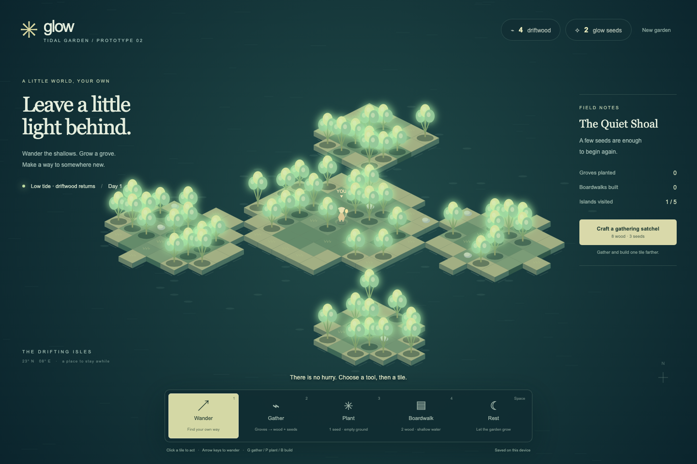
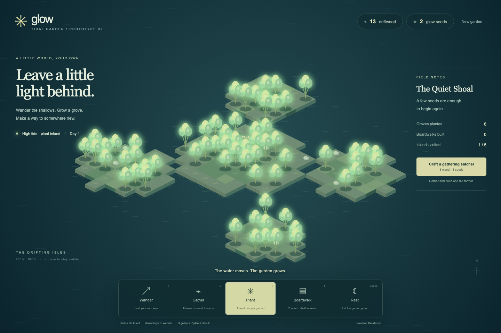
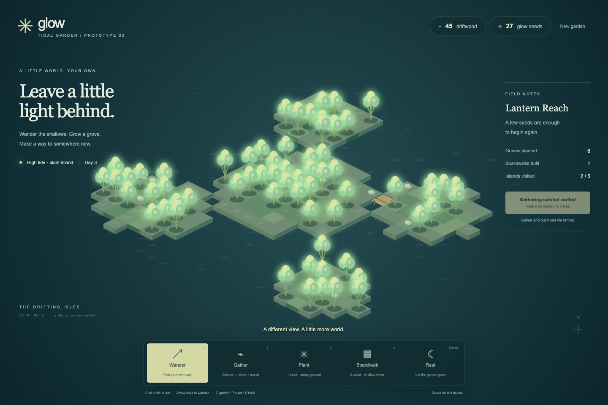

# Tidal Garden

1. Run `node prototypes/tidal-garden/server.mjs` from the repository root, then open http://127.0.0.1:4172. Requires Node.js 24+; no install or build. Set `PORT` to change the local port.
2. Choose Wander, Gather, Plant, or Boardwalk, then click a tile. Arrow keys move; `1`–`4` select tools; `G` gathers the nearest mature grove; `P` plants underfoot; `B` builds in the last movement direction; Space rests.
3. Groves provide 3 driftwood and 2 seeds, then regrow after four further successful actions. Planting costs 1 seed; boardwalks cost 2 driftwood and connect traversable land. The satchel costs 8 wood and 3 seeds and increases interaction reach from 2 to 3 tiles.
4. Every eight actions, the tide changes. At low tide, each shore tile offers 1 driftwood once per tide cycle. High tide prevents new shore planting; inland planting and travel remain available. There are no real-time deadlines or penalties for resting.
5. Five islands support free exploration and player-created gardens. Movement requires connected land or boardwalks. Progress saves locally after each action; New garden explicitly confirms before replacing it. Browser storage failure leaves a playable, session-only garden.
6. This is a standalone design prototype with a finite deterministic map and browser-owned state, not the proposed server-authoritative architecture. No multiplayer, backend, database, or offline progression. Canvas gameplay has keyboard controls and status announcements but is not a complete nonvisual interface.
7. Verified in headless Chrome: planting, gathering, regrowth, upgrade purchase, boardwalk construction, travel to a second island, save/reload, mobile fit, and absence of browser exceptions. Screenshots below show actual input-driven gameplay, not prefilled demo states.

## Screenshots

