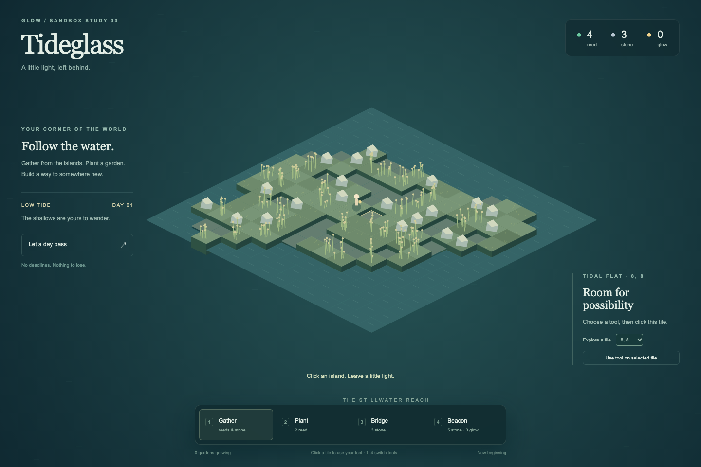
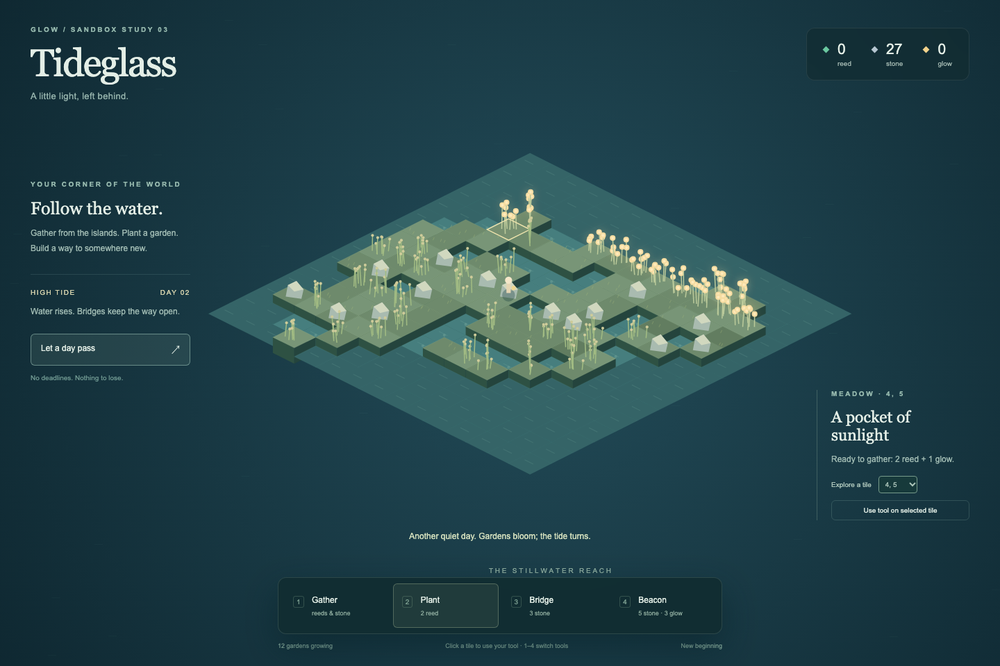
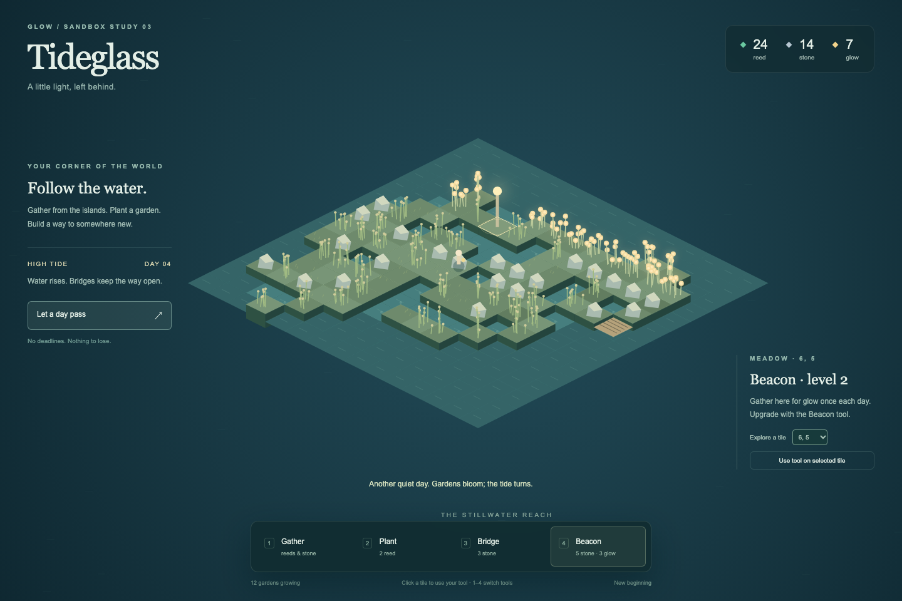

# Tideglass

1. Run `python3 -m http.server 8793 --bind 127.0.0.1 --directory prototypes/tideglass` from the repository root; open http://127.0.0.1:8793. No install or build required. Designed for desktop/tablet landscape.
2. Choose a tool with its button or keys **1–4**, then click a tile. Keyboard alternative: choose a coordinate and activate **Use tool on selected tile**. Gather reeds/stone; spend 2 reed to plant; pass a day to bloom; harvest 2 reed + 1 glow repeatedly.
3. Build bridges for 3 stone on water or tidal flats. Plant on bridges to extend the garden. Build or upgrade beacons for 5 stone + 3 glow; each beacon yields its level in glow once per day.
4. **Let a day pass** alternates tides, grows gardens, and replenishes some empty meadow resources. High tide blocks bare tidal flats; structures remain usable. Time advances only on request, with no loss, deadlines, or required route.
5. The finite 15×15 world implements the [game principles](../../docs/game-principles.md) as a calm creative sandbox. There is no movement constraint: the small caretaker is decorative. Exploration means choosing where to gather and expand. No multiplayer, server authority, procedural streaming, or CLI integration is claimed.
6. Changes save automatically in this browser's local storage. **New beginning** asks before replacing that save. If browser storage is unavailable, play continues without persistence. No external assets, dependencies, or network calls are required by the game.
7. Browser verification covered gathering, 12 gardens, harvesting, bridge construction, level-2 beacon upgrade, tides, save reload, and 1440×960 / 820×740 layouts; no runtime errors. Screenshots show real interactions from the same run, with no injected resources.

## Screenshots

